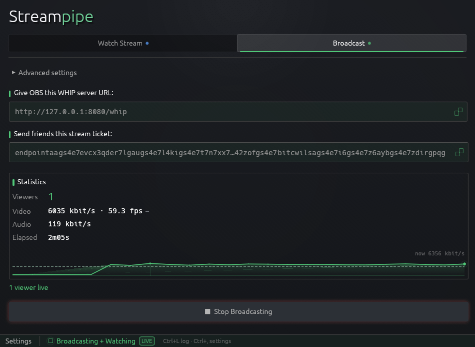

# Streampip

Streampipe uses [iroh](https://crates.io/crates/iroh) to broadcast video and
audio directly, peer-to-peer, with low latency to friends using streaming software like OBS.

Think of it like Discord screen-sharing, but with much higher bitrate/quality
for both audio and video, with no lag (on good internet connections) while hooking into all of the benefits of using a
local video player like mpv/vlc/ffplay for the viewing experience.

Run `streampipe` or double click the executable to open the GUI ([releases](https://github.com/RockasMockas/streampipe/releases) include pre-compiled binaries for x86 windows/linux).

## Broadcasting

Use the **Broadcast** tab to stream from OBS and broadcast it to friends.

1. Open the **Broadcast** tab.
2. *(Optional)* Expand **Advanced settings** to set the WHIP host, WHIP port,
   an optional bearer token, and optional fixed bind IPv4/IPv6 sockets. The
   defaults are fine for most cases.
3. Press **Start Broadcasting**. The status dot turns green and the tab
   reveals two click-to-copy boxes:
   - **Give OBS this WHIP server URL** — point OBS at this address.
   - **Send friends the stream ticket** — the ticket your viewers paste to
     watch. Copy it and send it to them.
4. In OBS, under `Settings > Stream`:
   - Service: `WHIP`
   - Server: the WHIP URL you copied from the first box
   - Bearer Token: the token you set in Advanced settings (leave empty if you
     did not set one)
5. Start streaming in OBS. The tab shows **Waiting for OBS to start
   streaming…** until the first frames arrive, then a live **N viewer(s) live**
   count and running statistics.
6. Press **Stop Broadcasting** when you are done.

## Watching

Use the **Watch Stream** tab to watch someone else's broadcast in your own
local player.

1. Open the **Watch Stream** tab.
2. Paste the **stream ticket** you received from the broadcaster into the ticket box.
3. Pick a **Player** from the dropdown (`mpv` by default, `ffplay`, `vlc`, or
   `none` to get just the stream description and open it yourself). (Note `ffplay` has lowest delay, followed my `mpv`, followed by `vlc`)
4. *(Optional)* Set a **Buffer (ms)** jitter buffer. Leave it blank for the
   lowest latency; raise it to 500-1000ms if issues arise.
5. Press **Watch Stream** (or press Enter). The app launches your chosen player, forwarding the stream to it.

The ticket box remembers the last ticket you used, so restarting a recent stream is just an Enter press away.

## Settings

The **Settings** button in the bottom menu bar opens a panel with two sections:

- **Broadcasting** — the current ticket (with **Reset Ticket** to mint a new
  one) and the log verbosity level.
- **Watching** — the default player (auto-selected on the Watch tab when the
  app opens), a per-player binary path for players not on `PATH`, the default
  buffer, and the local play address.

## Recommended OBS Settings

In personal testing across a few hundred kilometers of distance, it was possible to get as low as ~200-300ms delay with generally quite high quality video using these OBS settings:

- Audio Encoder: FFmpeg Opus
- Video Encoder: Nvidia nvenc H.264
- Rescale Output: Disabled
- Rate Control: Constant Bitrate
- Bitrate: 5000-20,000 kbps
- Keyframe Interval: 2s 
- Preset: P4 (Medium Quality)
- Tuning: Low Latency
- Multipass Mode: Single Pass
- Profile: High
- B-Frames: 0
